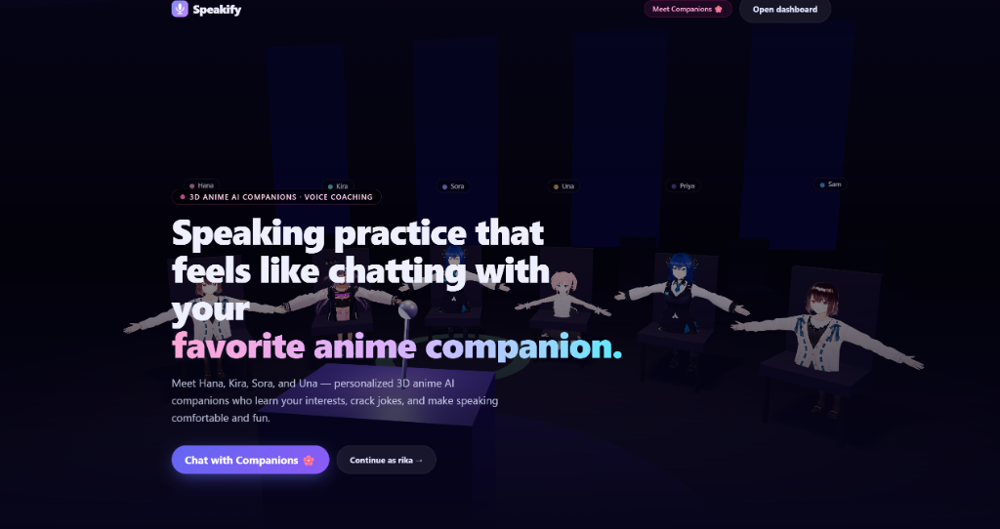
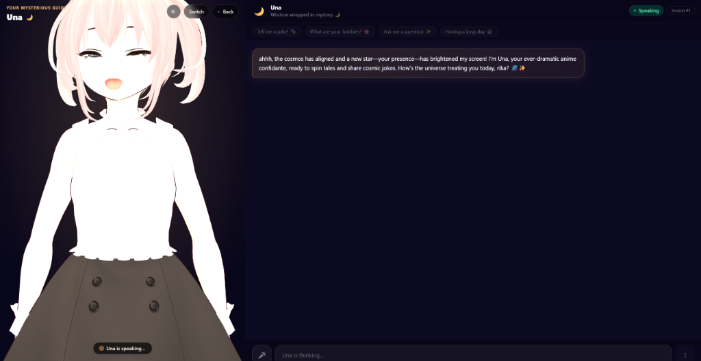
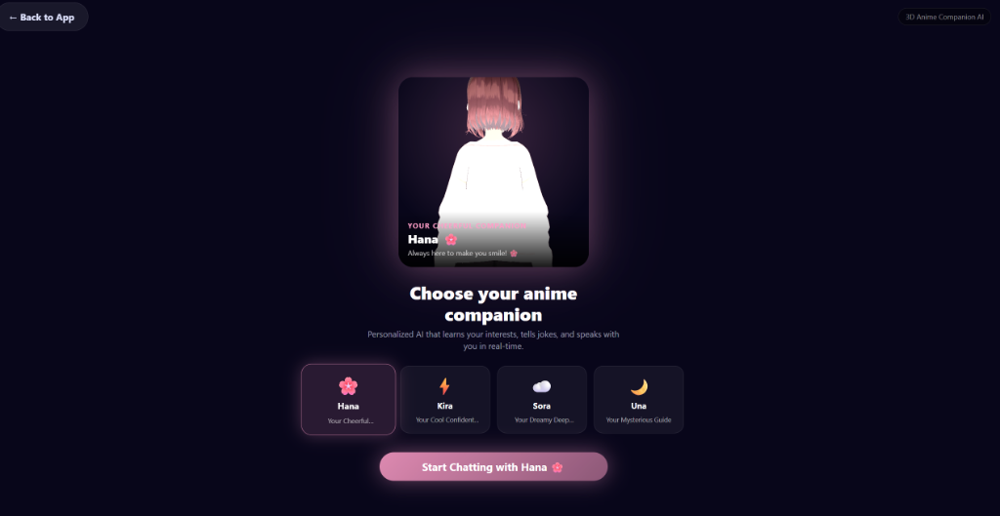
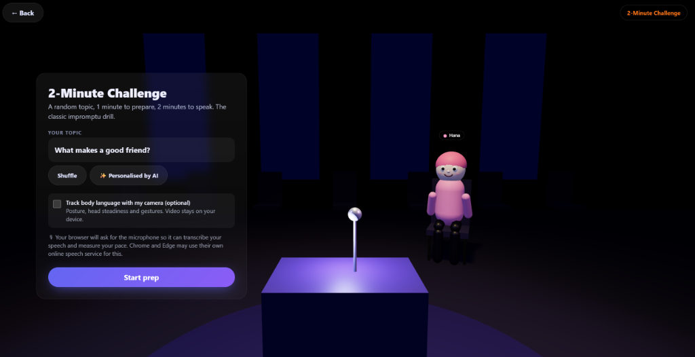

<div align="center">

# 🎙️ Speakify 🌸
### *Public Speaking Made Comfortable with 3D Anime AI Companions*

[](https://nextjs.org/)
[](https://www.typescriptlang.org/)
[](https://threejs.org/)
[](https://groq.com/)
[](https://www.netlify.com/)

<p align="center">
  <b>Speakify</b> transforms intimidating public speaking practice into a joyful, interactive conversation.<br />
  Practice in front of a live 3D anime audience or chat 1-on-1 with personalized AI companions from the <b>X G.I.R.L.S</b> project that remember your interests, crack funny jokes, and cheer for your growth.
</p>

---



</div>

<br />

## 🌟 Key Highlights

- 🌸 **Authentic 3D Anime VRM Companions (from X G.I.R.L.S)**: Live 3D VRM avatar rendering with `@pixiv/three-vrm` + WebGL, featuring head tracking, eye blinking, wide alert eyes, and talking mouth synchronization.
- 🎙️ **Two-Way Voice Speaking Sessions**: Speak naturally into your microphone with live Web Speech recognition and receive spoken responses with real-time lip-syncing.
- 🧠 **Continuous Interest Learning & Memory**: Companions automatically extract your hobbies, favorite shows, games, and passions from conversations and remember them across sessions.
- 🎭 **Humor & Stress-Free Banter**: One-click joke triggers (`Tell me a joke! 🎭`, witty anime banter, lighthearted puns) that dissolve stage fright and make you comfortable speaking.
- 👥 **Interactive 3D Virtual Audience**: The auditorium audience stands at attention on stage, nods in agreement when you speak well, and waves hello (`👋`) one at a time.
- 📊 **Real-time Delivery Analytics**: Measures pace (WPM), tracks filler words (`um`, `like`, `actually`), analyzes pause duration, and offers optional MediaPipe posture tracking.
- 💫 **Interactive Dashboard Companion Overlay**: Your companion lives directly on your dashboard, commenting on your latest scores and offering quick warm-up drills.

---

## 📸 Feature Showcase

### 1. Interactive 1-on-1 Companion Chat
> *Real-time two-way voice conversation with 3D anime VRM characters who learn your interests and crack jokes.*

<div align="center">
  
</div>

- **Microphone Voice Input**: Speak directly to your companion; speech is transcribed in real-time.
- **Voice Speech Output & Lip-Sync**: Smooth viseme mouth movement synchronized with browser speech synthesis.
- **Quick Conversation Starters**: Instant buttons like *"Tell me a joke! 🎭"*, *"What are your hobbies? 🌸"*, and *"Having a long day ☕"*.
- **Memory Toast Notifications**: Real-time notifications appear whenever your companion learns a new interest (`✨ Hana learned you like: anime, coding`).

---

### 2. Meet the Anime Characters (from X G.I.R.L.S)
> *Choose your speaking companion based on the vibe that makes you feel most comfortable.*

<div align="center">
  
</div>

| Character | Role | Tagline & Personality | VRM Model |
| :--- | :--- | :--- | :--- |
| **Hana 🌸** | Your Cheerful Companion | *"Always here to make you smile! 🌸"*<br />Warm, optimistic, tells silly puns, laughs (`hehe~`), and celebrates every step of your progress. | `AvatarSample_B.vrm` |
| **Kira ⚡** | Your Cool Confident Buddy | *"Let's level up together! ⚡"*<br />Energetic, witty one-liners, playful challenges, and friendly banter to keep you energized. | `AvatarSample_C.vrm` |
| **Sora ☁️** | Your Dreamy Deep Thinker | *"Let's explore ideas together ☁️"*<br />Introspective, philosophical, shares surreal humor, and asks thoughtful questions about your dreams. | `AvatarSample_A.vrm` |
| **Una 🌙** | Your Mysterious Guide | *"Wisdom wrapped in mystery 🌙"*<br />Theatrical, dramatic, offers grand poetic prophecies, and weaves your passions into ancient lore. | `Unagirl.vrm` |

---

### 3. Practice Sessions & Live 3D Auditorium Drills
> *Step onto the virtual stage and practice real-world speaking scenarios.*

<div align="center">
  
</div>

- **2-Minute Challenge**: 1 minute to prep, 2 minutes to talk on an impromptu AI-generated topic.
- **Public Session**: Speak to a 3D audience that listens attentively and asks follow-up Q&A questions.
- **Discuss Session**: 1-on-1 conversational drill to practice casual, engaging dialogue.
- **Debate Session**: Present your argument to a critical listener who challenges your assumptions.

---

## 🛠️ Technology Stack

| Layer | Technology |
| :--- | :--- |
| **Framework** | [Next.js 16](https://nextjs.org/) (App Router, Turbopack) |
| **Language** | [TypeScript 5.7](https://www.typescriptlang.org/) |
| **3D Rendering** | [Three.js](https://threejs.org/) & [@pixiv/three-vrm](https://github.com/pixiv/three-vrm) 3.5 |
| **Canvas Integration** | [@react-three/fiber](https://docs.pmnd.rs/react-three-fiber) & [@react-three/drei](https://github.com/pmndrs/drei) |
| **AI LLM Engine** | [Groq](https://groq.com/) Cloud API (`openai/gpt-oss-120b`, `openai/gpt-oss-20b`) |
| **Speech & Audio** | Web Speech API (`SpeechRecognition` & `SpeechSynthesis`) |
| **Body Tracking** | [@mediapipe/tasks-vision](https://developers.google.com/mediapipe) (On-device Pose Landmarker) |
| **Styling** | [Tailwind CSS 4](https://tailwindcss.com/) |
| **Deployment** | [Netlify](https://www.netlify.com/) / [Vercel](https://vercel.com/) |

---

## 🚀 Quick Start Guide

### Prerequisites
- Node.js `20.x` or higher
- A free [Groq API Key](https://console.groq.com/keys)

### 1. Clone & Install
```bash
git clone https://github.com/<your-username>/speakify-web.git
cd speakify-web
npm install
```

### 2. Configure Environment
Copy the example environment file and add your Groq API key:
```bash
cp .env.example .env.local
```
Inside `.env.local`:
```env
GROQ_API_KEY=gsk_your_groq_api_key_here
```

### 3. Launch Development Server
```bash
npm run dev
```
Open [http://localhost:3000](http://localhost:3000) in your browser.

---

## 🌐 Deploying to Netlify

This project is configured out-of-the-box for Netlify via `netlify.toml`:

1. Push your repository to **GitHub**.
2. Log in to [Netlify](https://app.netlify.com/) and click **Add new site → Import an existing project**.
3. Select your GitHub repository.
4. In **Site Configuration → Environment Variables**, add:
   - `GROQ_API_KEY`: your Groq API key.
5. Click **Deploy speakify-web**. Netlify will build with `@netlify/plugin-nextjs` and launch your live site!

---

## 🔒 Privacy & Architecture

- **Zero Audio Uploads**: Voice speech recognition and synthesis run entirely in your local browser using the Web Speech API.
- **Private API Keys**: The Groq API key is accessed exclusively via secure server-side Next.js route handlers (`/api/*`) and is never leaked to the client bundle.
- **Local Storage**: User profiles, learned interests, and session history reside safely inside your browser's `localStorage`.

---

<div align="center">
  <sub>Built for students, presenters, and anime fans to make public speaking second nature. 🌸</sub>
</div>
